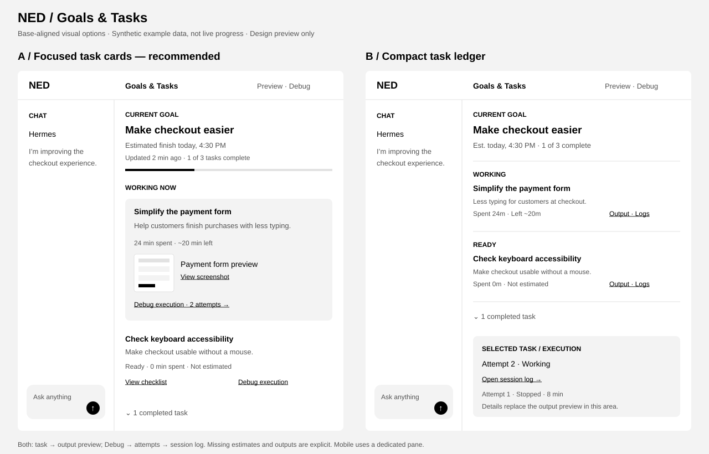

# Goals and tasks: Base design direction

Status: compact A implemented as source candidate; not yet deployed.
Decision owner: project user. Revision: 3. PR mode: MERGEABLE.

## DEC-01: Choose the task presentation

- **A — Focused task cards (recommended):** current goal first, active task with a visible output, remaining tasks below. A small Debug execution link opens attempts, then the corresponding session log. Optimizes answering what is happening and seeing its result without hunting.
- **B — Compact task ledger:** denser rows, selected output or execution detail in a shared lower region. Fits more tasks but requires selection to inspect results.

The user selected A with less text in the first view. The first view contains the goal name and estimated finish, task title and status, compact spent/left timing, a small output thumbnail or document link, and a subtle Details action. Hide impact descriptions and execution detail until Details is opened. Highlight active work; keep queued tasks compact and completed work collapsed. The image above is the original comparison, not a final pixel contract for this compact revision. Uber Base is the selected design system. Synthetic fixture times and content are not live measurements or delivery promises.

## Shared behavior

- Keep chat available, with Goals & Tasks in the right project pane alongside existing Preview and Dashboard views. Preserve the separate hideable Debug pane.
- Current goal selection must follow real active work; multiple active goals must not be silently presented as one. Tasks without a goal remain visible.
- Show measured execution duration separately from estimated remaining duration. Do not call wall-clock task age time spent. No reliable estimate means **Not estimated**; no recorded timing means **Time not recorded**.
- Each task has its title, one-line product/business impact, status, spent/remaining time and visible outputs. Missing impact is explicit, not generated from an arbitrary title.
- Output previews support project-authorized screenshots and short documents. No output means **No output yet**, not a placeholder presented as a result. Preview untrusted documents safely; do not execute HTML or load arbitrary external images.
- Debug execution is secondary. Drill-down is task → paginated attempts → corresponding session log. Unbound, unavailable and expired sessions remain distinguishable. Opening details must not start or retry work.
- Mobile exposes the same view through existing navigation rather than adding a permanently narrow column. Maintain accessible labels, focus return, keyboard operation and 44px touch targets.

## Adoption boundary and sources

Uber Base is the requested project-wide default, not another optional theme. Audit and consolidate existing COM tokens before migration; the existing [design-system contract](design-system.md) remains authoritative until the adopted replacement is frozen. Do not introduce a second competing token authority.

Official sources:
- [Base design system](https://base.uber.com/6d2425e9f/p/294ab4-base-design-system)
- [Base design language](https://base.uber.com/6d2425e9f/v/0/p/76be65-design-language)
- [Base typography](https://base.uber.com/6d2425e9f/p/976582-typography-10/b/667160)
- [Base Web React implementation](https://baseweb.design/)
- [Base Web MIT license](https://github.com/uber/baseweb/blob/main/LICENSE)

Adopt Base foundations and interactions in the existing native-HTML COM architecture; Base Web is a React implementation, so its existence alone is not a reason to rewrite chat in React. Confirm token provenance and licenses before copying code or assets. Use the system font fallback unless redistribution permission for a specific Uber font is established; no permission is inferred from the software license. The mock uses neutral sans-serif and a monochrome hierarchy with semantic status text, not proprietary Uber assets.

## Data gaps discovered

The existing project-work reader returns hierarchy, titles, statuses, priorities, creation timestamps and dependencies; it currently omits even stored descriptions. It does not expose estimates, impact summaries, output attachments or measured task duration. Core already persists attempts and session bindings and exposes attempt results. Implementation must extend an authorized read model rather than present mock data as live or expose the operator credential to browser code. Session-log authorization and output provenance require explicit design before implementation.

## Feedback disposition log

| ID | Source | Disposition | State |
| --- | --- | --- | --- |
| DEC-01 | User selects A with less text in the first view | Compact A; impact description and execution drill-down behind Details | Accepted |
| DEC-02 | User requests execution links and visible outputs | Details → attempts → bound session logs; screenshots/documents on cards | Implemented candidate |
| DEC-03 | User selects Uber Base as default | Shared COM tokens and canonical project baseline, not per-pane theme | Implemented candidate |
