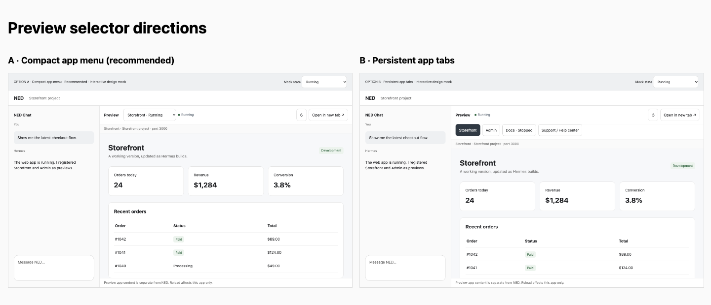
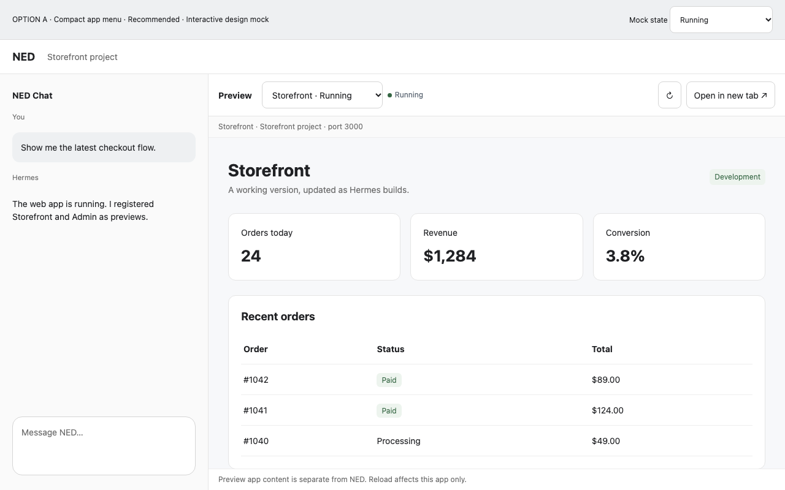
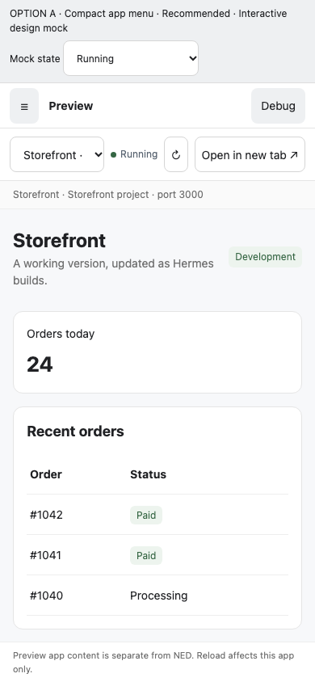
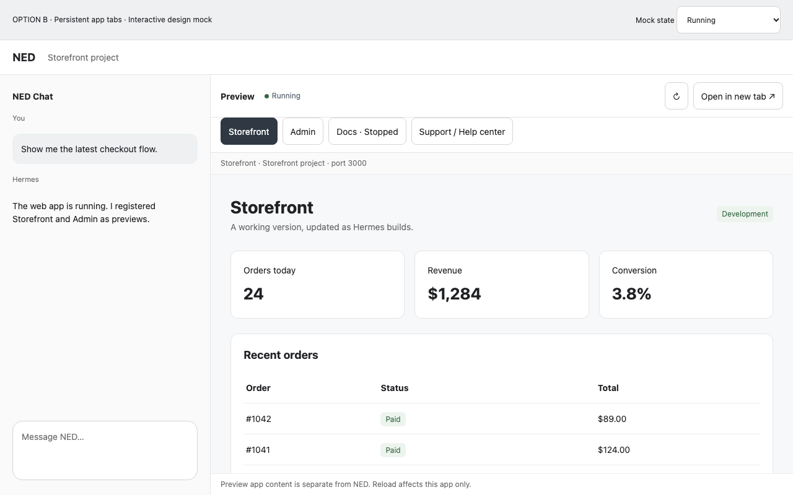
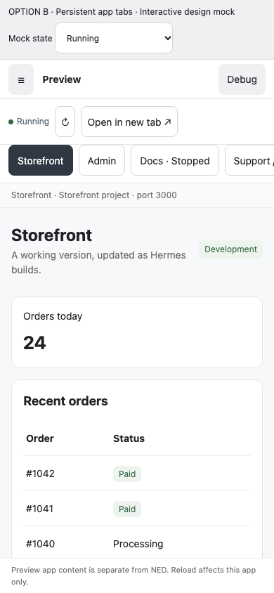
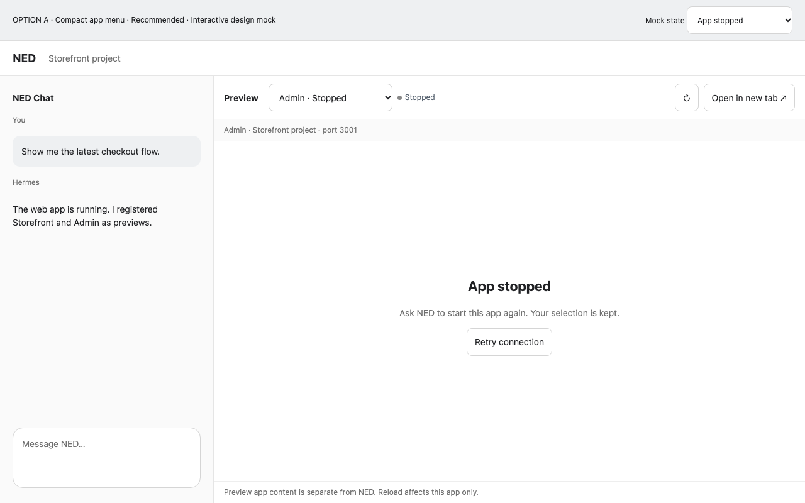
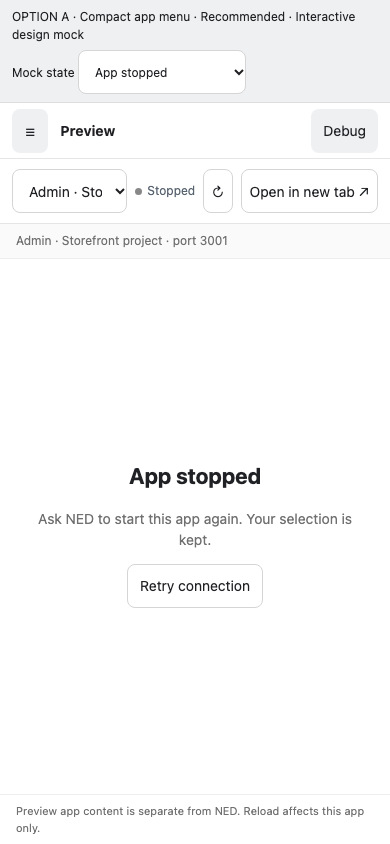
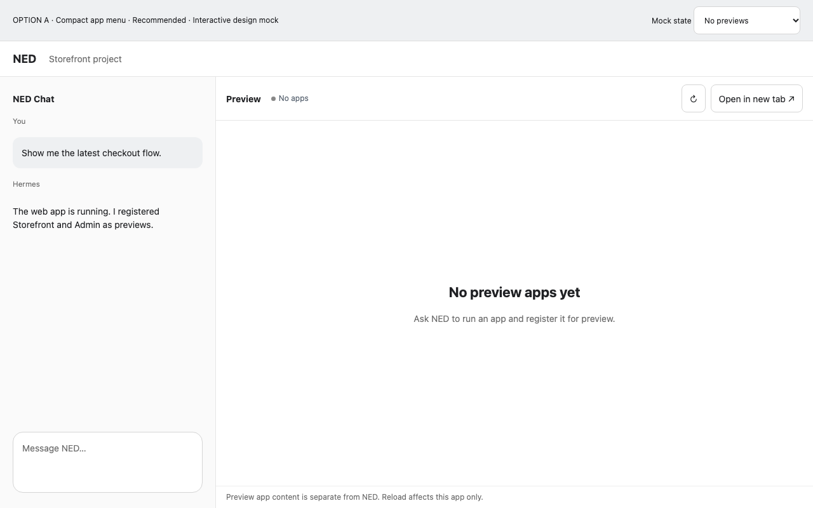
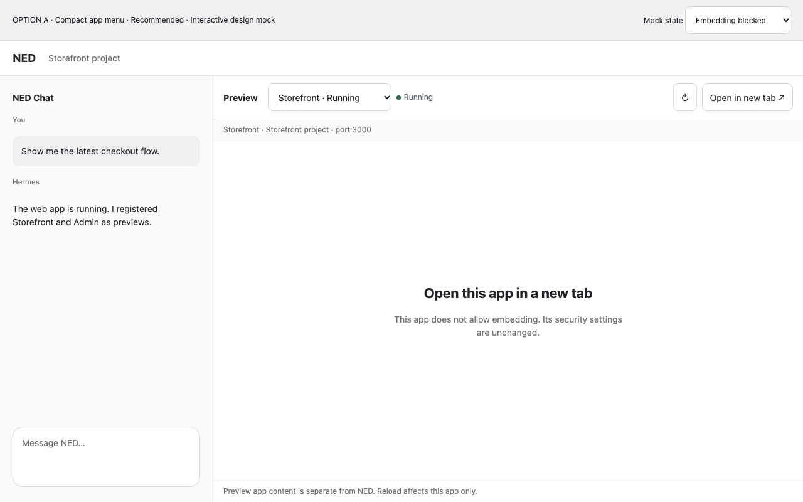

# Web app previews — design review

Status: draft proposal · revision preview-design-r2 · lineage preview-155 · decision owner: project user · decision requested: DEC-01 · PR mode: MERGEABLE documentation proposal, not runtime implementation.
Canonical [spec](../SPEC.md), [architecture](../TECHNICAL_DESIGN.md), [UI brief and acceptance IDs](ui-brief.md), [runnable prototype](options.html?variant=A). GitHub shows HTML source rather than executing it; open the local HTML file to interact. The images below render directly in the review page. No real app, tunnel or authentication is running in these mocks.

## UI-A — compact app menu (recommended)

- Scales to more apps and longer names, without a second navigation strip.
- One app opens automatically; switching normally takes two pointer actions.
- Same private relay/lifecycle and project-aware behavior as B.

## UI-B — persistent app tabs

- One-click switching when the target tab is visible.
- Uses more vertical space and needs overflow/keyboard behavior as apps grow.
- Useful when users repeatedly alternate between two or three apps.

## SCREEN-03 — app stopped (same recovery in either direction)

Retry reconnects; it does not start the app. Hermes owns starting/restarting. Embedding restrictions retain Open in new tab; no security headers are removed to make framing work. Empty/reconnecting/blocked states are selectable in the prototype.

## SCREEN-04 — additional recovery states

## Evidence index and annotations

| Direction / state | Clean desktop / mobile | Annotated desktop / mobile |
| --- | --- | --- |
| A, running | [desktop](evidence/a-desktop.png) / [mobile](evidence/a-mobile.png) | [desktop](evidence/a-desktop-annotated.png) / [mobile](evidence/a-mobile-annotated.png) |
| B, running | [desktop](evidence/b-desktop.png) / [mobile](evidence/b-mobile.png) | [desktop](evidence/b-desktop-annotated.png) / [mobile](evidence/b-mobile-annotated.png) |
| Stopped | [desktop](evidence/a-stopped-desktop.png) / [mobile](evidence/a-stopped-mobile.png) | A1–A6 in [UI brief](ui-brief.md#interaction-contract) |
| Empty / reconnecting / blocked | [empty](evidence/a-empty.png) / [reconnecting](evidence/a-reconnecting.png) / [blocked](evidence/a-blocked.png) | A3/A5/A6 in UI brief |

Annotations use stable A1–A7 interaction IDs from the UI brief. Review chrome's Mock state control is prototype-only. The live app viewport and lifecycle are simulated. No runtime logs, accounts or secrets are present.

## DEC-01 — choose the selector

| Decision factor | A: menu | B: tabs |
| --- | --- | --- |
| Zero-to-one app | Automatic selection | Automatic selection |
| Common app switch | Open + choose | One visible tab click |
| Many apps / long names | Compact, project grouping | Scroll/overflow required |
| Mobile | More app viewport height | Extra navigation row |
| Accessibility complexity | Native select | Custom tab keyboard/overflow |
| Recommendation | **A** | Choose for frequent small-set switching |

Choose A or B, combine them, or request a revision. The recommendation is not a recorded approval. Backend registration, isolation and HMR design are shared by both, so technical discovery can continue while the choice is pending. PRD freeze and runtime implementation must wait for the choice and independent review.

## Design versus product evidence

Prototype interactions and desktop/mobile geometry were exercised with synthetic apps. Screenshots show a design, not successful port registration, auth, isolation, remote access or HMR. Planned runtime acceptance is SPEC TC-001–006; NOT RUN. Current manual design case TC-007 remains partially complete until DEC-01 is selected.

The surrounding shell is illustrative: implementation reuses actual COM navigation, resize and chat, rather than replacing it with a new navigation system. The mock starts in Preview, not the real initial Chat state. App names/metrics/orders are synthetic content belonging to an example app, not NED controls.

## Feedback disposition log

| Thread / source | Stable ID | Authority | Disposition | Revision / state |
| --- | --- | --- | --- | --- |
| Direct user request: agent registers port and user switches apps | FR-001, FR-005 | Project user | Included in both directions | r2 / drafted |
| Async preference question in this chat | DEC-01 | Project user | Pending; no answer assumed | r2 / open |

## Changes in r2

Stopped/offline/empty chooser labels and identity now derive from the same synthetic app state; empty disables/hides both variants without inventing a running app. Captures and contact sheet were regenerated. Technical contract corrections separate fixed namespace CSP from exact route authorization, distinguish bootstrap request classes and transient trusted form state, prohibit workers for the first release, gate local cookie/site compatibility, narrow app-cookie/HMR support honestly, and preserve all runtime proof gates. These changes do not select DEC-01 or implement preview services.
